# SHADOW SIX

A real-time stealth tactics game in your browser: a fan remake of **Commandos: Behind Enemy Lines** (1998) built
with three.js. Six specialists, enemy vision cones, a fixed 3/4 camera and WWII missions behind enemy lines.

**▶ Play now in your browser (nothing to install): <https://jaher.github.io/shadow-six/>**

> **Fan tribute, not an official game.** SHADOW SIX is an unofficial, non-commercial fan tribute to
> *Commandos: Behind Enemy Lines* (Pyro Studios / Eidos Interactive, 1998). It is not affiliated with, endorsed
> by or connected to Pyro Studios, Eidos, Square Enix or Kalypso Media. 'Commandos' is a trademark of its owner.
> No assets from the original game are used; all art, audio and code are original or CC0/redistributable
> (see [CREDITS.md](CREDITS.md)).

## Mission storyboards

A mission with a scripted solution can be filmed: the art opening (the title card over a slow pan of the map, from the
objective to the team's start), then the whole solution played in the real game with player orders only and captioned
step by step, down to the *Mission complete* card. Each sheet below is a 4 × 4 contact sheet of one film, in film
order (click it for the full-size image); the numbers are the film's own: game time, detections, enemies killed,
commandos alive. Every mission has its film. How to make one: [Film a mission](#film-a-mission); the films themselves
are not in the repository.

### Sandbox (mission 0)

The Sniper shoots the officer, the compound patrol and the bridge sentry; the Sapper's bear trap takes the road patrol and his time bomb the fuel depot; the Green Beret knifes the depot guard. *Game time 6:08 (film 1:36), 0 detections, 5 kills, all 3 commandos alive.*

[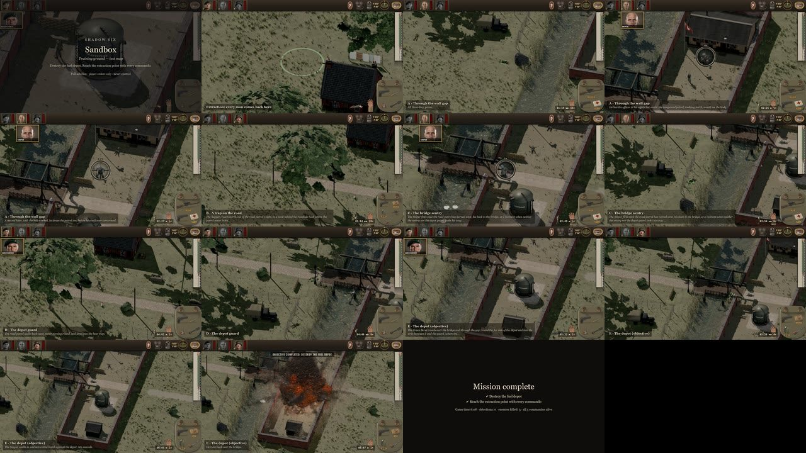](docs/screenshots/storyboards/m00.jpg)

### Mission 1 · Baptism of Fire

The Green Beret knifes the road sentry; the Marine swims round the peninsula, harpoons a second guard and rafts the Green Beret up the fjord; the Green Beret carries a fuel drum to the relay station and sets it off with one pistol shot. The Driver takes no part. *Game time 18:10 (film 2:20), 0 detections, 2 kills, all 3 commandos alive.*

[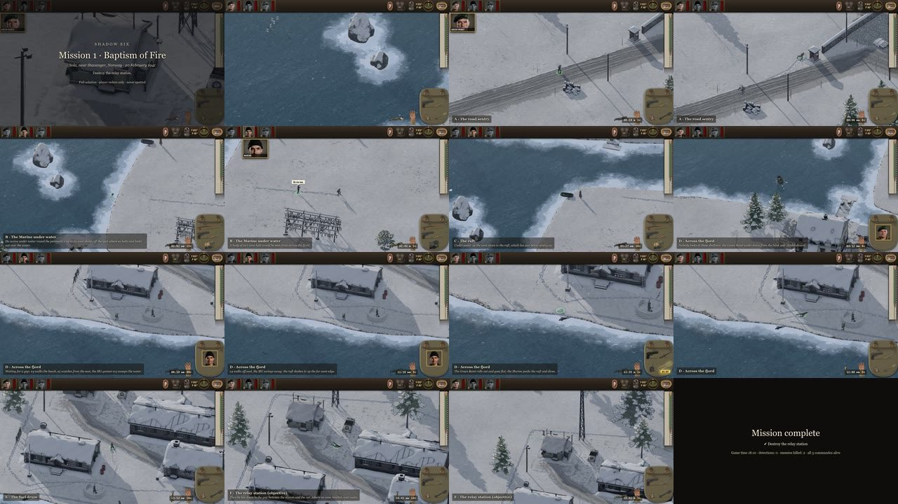](docs/screenshots/storyboards/m01.jpg)

### Mission 2 · A Quiet Blow-Up

The Sapper's bear trap takes two guards, the Marine's speargun one, the Sniper two shots across the river and the Green Beret's knife two more inside the camp; the Marine rafts the team over, the Sapper blows the fuel depot and the Driver drives the truck out. *Game time 20:00 (film 3:34), 0 detections, 7 kills, all 5 commandos alive.*

[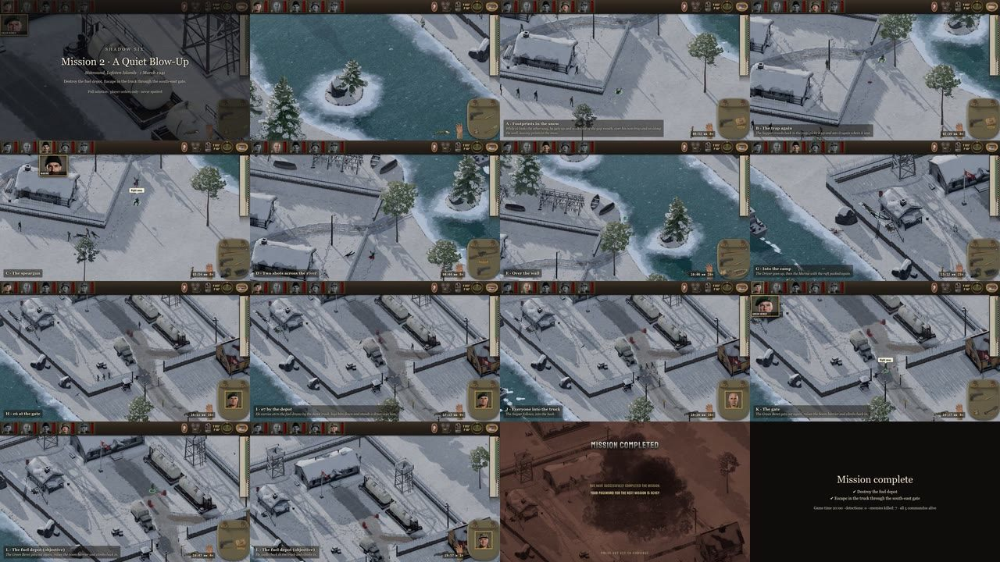](docs/screenshots/storyboards/m02.jpg)

### Mission 3 · Reverse Engineering

The Marine harpoons three guards, the Green Beret knifes four and works a decoy, the Sapper's trap takes the sergeant, the Spy takes a uniform and switches the fence off; the Sapper's charges destroy the bunker (and its gunner) and the dam, and all four leave in the truck. *Game time 45:03 (film 8:19), 0 detections, 9 kills, all 4 commandos alive.*

[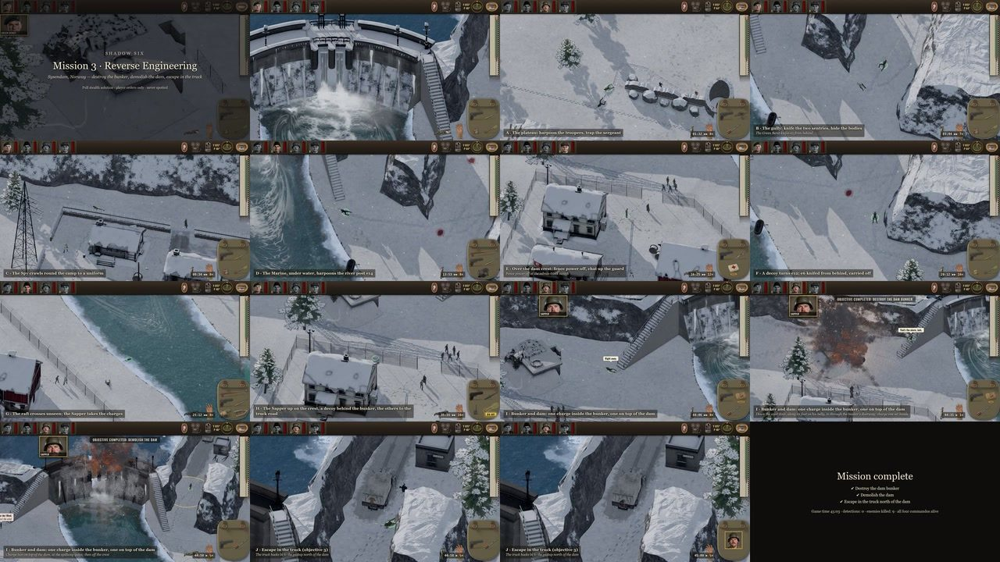](docs/screenshots/storyboards/m03.jpg)

### Mission 4 · Restore Pride

The Marine harpoons e2 from the corner of the rubble in the yard south, and the Green Beret knifes e1 and e3 behind him; at the wire gap the Green Beret plants his decoy, draws e17 over to it and knifes him, and in the centre grove he knifes e12 while a train runs between him and e19; at the bridge the Sniper shoots e19, the machine-gunner e20 and e25 as Patrol 19 turns away, the Green Beret and the Marine come out behind the file and the Green Beret knifes the other four, and the Sniper shoots the courier e26 at the far end; the team crosses the deck between two trains; the Driver and the Sapper take the courier's motorcycle to the RAF air-drop, where the Sapper takes the charge; the Green Beret's decoy draws e54 off the cliff edge and the Driver runs him down, and a second decoy turns the lawn guard e59 away from the pier shed; the Driver rides the Sapper behind the supply lorry to the villa's front steps, the Sapper sets a time bomb there and is back on the motorcycle when the headquarters goes up (the lorry driver at the door dies with it), the Sniper shoots the pier guard e56, and all five run down the pier stair and step aboard the patrol boat while e13 looks away. *Game time 35:10 (film 6:25), 0 detections, 16 kills, all 5 commandos alive.*

[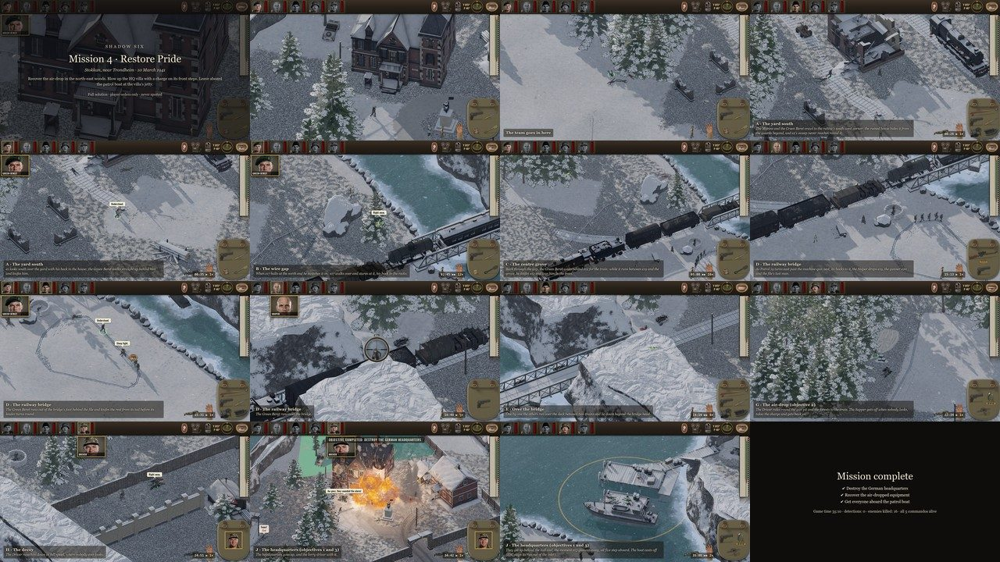](docs/screenshots/storyboards/m04.jpg)

### Mission 5 · Blind Justice

The Spy rides the cable car in a German uniform and injects five guards; the Green Beret knifes one, climbs the east cliff and puts a fuel drum by the radar; the Spy's pistol shots set off the drums that destroy the barracks (with a three-man patrol) and the radar, and both fly out in the autogyro. *Game time 14:59 (film 3:05), 0 detections, 9 kills, both commandos alive.*

[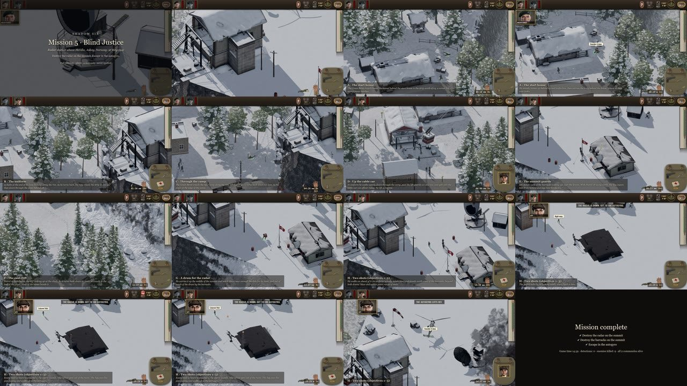](docs/screenshots/storyboards/m05.jpg)

### Mission 6 · Menace of the Leopold

The Green Beret knifes one guard and lays a decoy; the Sniper shoots one guard on the way in and two after the blast; the Sapper's charge destroys the Leopold railway gun and a guard beside it; all three board the truck. *Game time 36:04 (film 4:47), 0 detections, 5 kills, all 3 commandos alive.*

[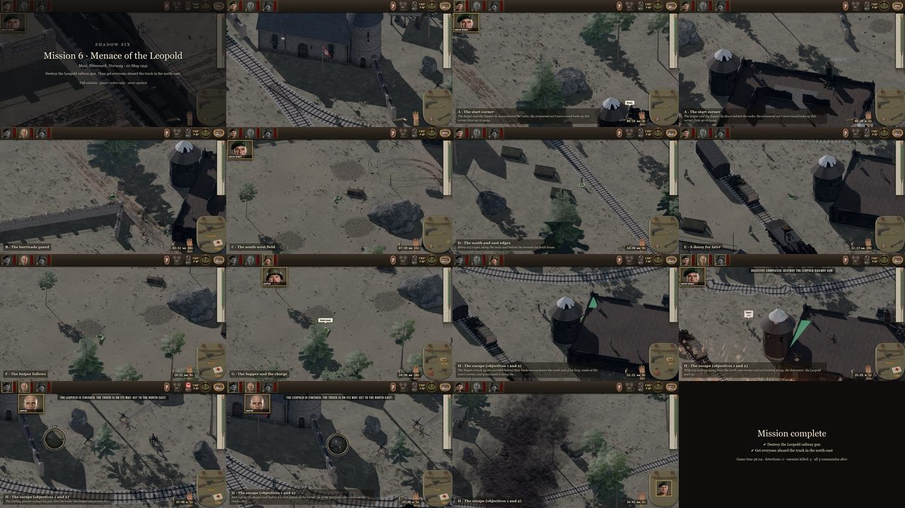](docs/screenshots/storyboards/m06.jpg)

### Mission 7 · Chase of the Wolves

West, the Spy takes a German uniform from the clothesline, injects the gunner of gun 23 and the dock yard's two walkers, e15 and e16, holds patrol 14 in talk while the Sapper takes the four time bombs from the air-drop crate, and holds patrol 21 at the slipway while the Sapper and the Driver crawl down the yard to the quay's edge; east, the Green Beret's decoy holds the heights' two sentries and patrol 3 and a line of prints draws e5 to it, the Green Beret knifes e4, e6 and the rear man of patrol 10 while the Marine harpoons its sergeant and then e11 from the water, and the Marine takes the rowboat, the Green Beret steps in, and he rows it round the lighthouse to the pens; at gun 23 the rowboat picks up the Sapper, the Driver and the Spy, who keeps e20 in talk; the Sapper sets a time bomb by the torpedoes on U-boat 1's after deck and, from the rowboat, another on U-boat 2; all five row round the lighthouse to the red buoy. *Game time 37:18 (film 6:06), 0 detections, 8 kills, all 5 commandos alive.*

[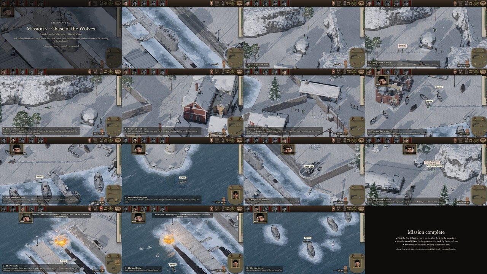](docs/screenshots/storyboards/m07.jpg)

### Mission 8 · Pyrotechnics

The Green Beret knifes sixteen guards from behind, several drawn in by a decoy, and carries three barrels into place in and beside the oil store; the Sniper shoots five guards, and his sixth round sets off a chain of barrels that destroys the oil store, the reservoir and both fuel tanks (and three more guards); both leave in the jeep. *Game time 111:28 (film 10:10), 0 detections, 24 kills, both commandos alive.*

[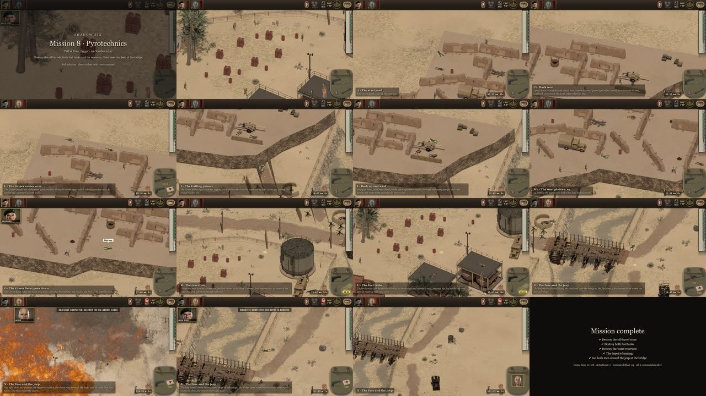](docs/screenshots/storyboards/m08.jpg)

### Mission 9 · A Courtesy Call

The Green Beret knifes seven guards (the three-man patrol outside the south-east wall, the forecourt's e3 and the three-man patrol outside the west wall) and carries the forecourt's dead out of sight; the Sniper shoots five (the forecourt's e2 and e1, and the courtyard patrol's three men through the gap while the Spy holds their sergeant in talk); the Spy, in German uniform, injects six (the north yard's four guards and the east gate's two); the Sapper plants a remote bomb at the barracks door and another between the radio hut and the dish; the Driver parks the fuel tanker across the Panzers' bays; the first blast razes the barracks and raises the alarm, the woken Panzers shoot the tanker and its fireball wrecks all three, and the Green Beret's pistol shots set off a fuel drum at the bunker and the drum pile (weapons store and command post); all five drive out in the lorry that comes in along the west road. *Game time 12:45 (film 4:20), 0 detections, 18 kills, all 5 commandos alive.*

[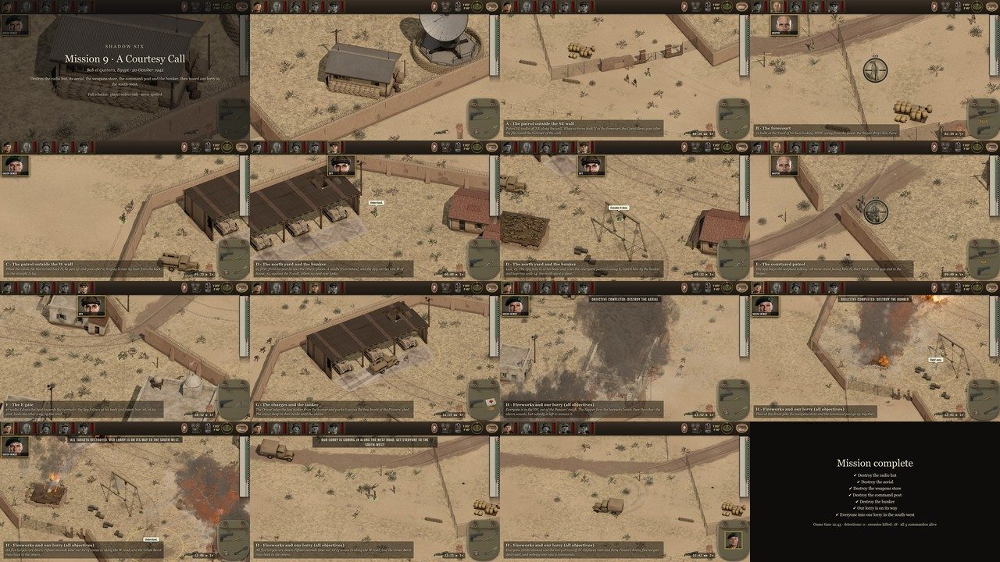](docs/screenshots/storyboards/m09.jpg)

### Mission 10 · Operation Icarus

The Green Beret knifes twelve guards (the four sentries in the ruins, Patrol 4's three men, the guard on the compound's west wall and the compound's four, five of them drawn to a decoy first) and frees McRae from the cage; the Sapper's time bomb destroys the bomb store; the Sniper shoots two machine-gunners covering the road up to the airfield and the Sapper's two grenades kill the nine men in the dugout at the ramp head; McRae flies the Junkers out with the team aboard. *Game time 21:14 (film 4:53), 0 detections, 23 kills, all 4 commandos alive.*

[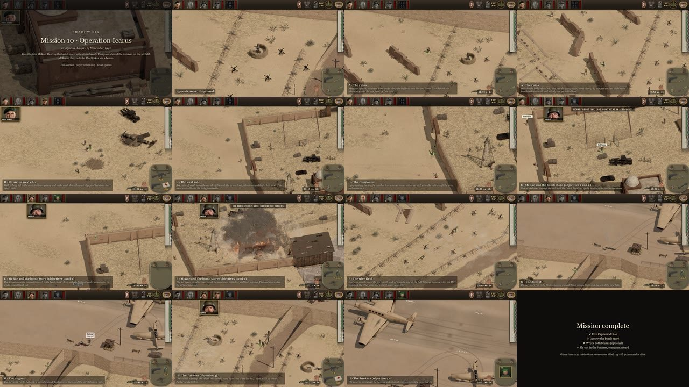](docs/screenshots/storyboards/m10.jpg)

### Mission 11 · In the Soup

The Spy, in uniform, injects the gate sentry and four valley guards; the Sapper plants three remote bombs; the Driver takes the half-track through the yard and fires its gun at the quarry's fuel truck, which takes both quarry rigs, and the Sapper's detonator takes the yard and valley rigs; all five drive out in the half-track. *Game time 17:11 (film 4:26), 0 detections, 5 kills, all 5 commandos alive.*

[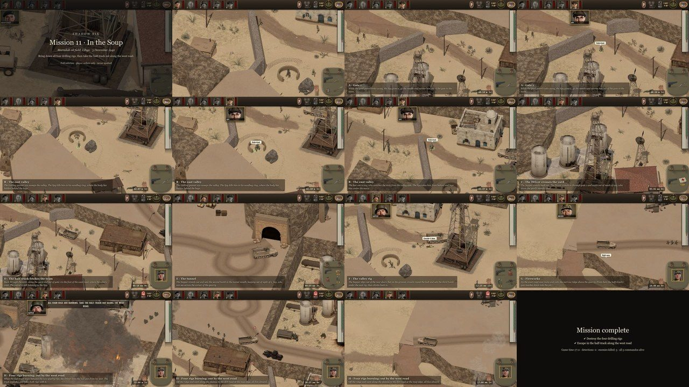](docs/screenshots/storyboards/m11.jpg)

### Mission 12 · Up on the Roof

The Spy, in uniform, injects eleven guards from behind and holds others in talk with their backs turned; the Green Beret knifes eight and opens the cell door to free the Informer; the Sniper shoots five roof guards one after another; the Green Beret, the Sniper and the Informer crawl over the roofs to the mosque platform, and all four drive off in the car on the quay. *Game time 16:22 (film 4:08), 0 detections, 24 kills, all 3 commandos alive.*

[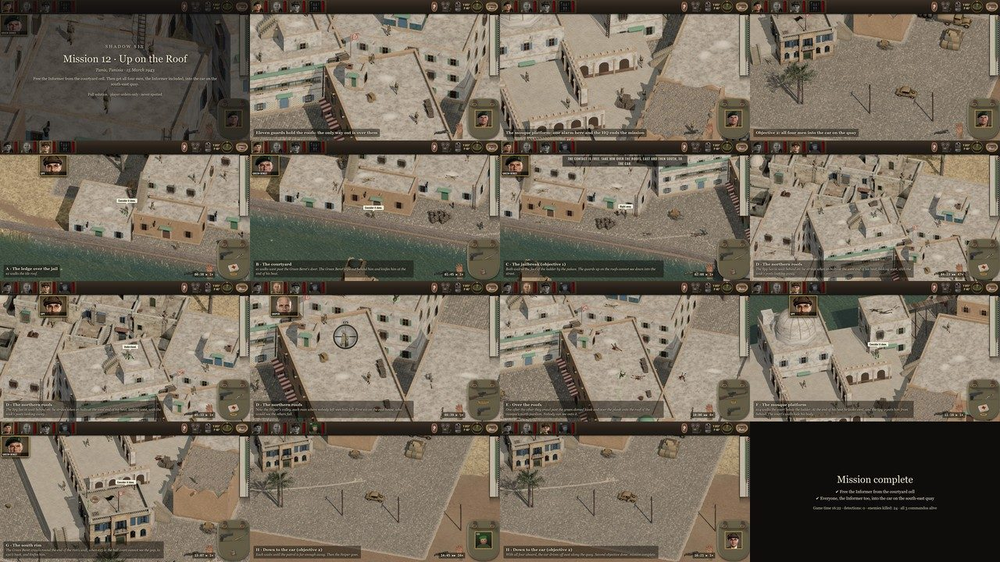](docs/screenshots/storyboards/m12.jpg)

### Mission 13 · David and Goliath

The Marine spears eleven guards from the water, opens both lock gates and rafts the team in; the Green Beret knifes six, the Sniper shoots four and the Sapper's bear trap takes one; the Driver blocks the garage door with a truck; the Marine's mini-sub torpedo sinks the battleship by the bow, the Sapper's remote charge blows the fuel tanks and the Driver sinks a patrol boat with the pier gun; all five row out to the red buoy. *Game time 53:19 (film 9:29), 0 detections, 22 kills, all 5 commandos alive.*

[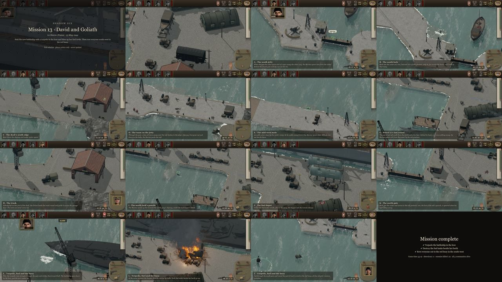](docs/screenshots/storyboards/m13.jpg)

### Mission 14 · D-Day Kick Off

The Marine rows the boat and spears ten guards; the Sniper shoots seven; the Green Beret knifes one, holds a guard's eyes with a decoy and stands a fuel barrel by gun 4; the Sapper sets remote charges on guns 1, 2 and 3; the Sniper's shot into the barrel destroys gun 4 and the Sapper fires the other three from the sea (four guards die with them); all five row out to the red buoy. *Game time 46:07 (film 7:05), 0 detections, 22 kills, all 5 commandos alive.*

[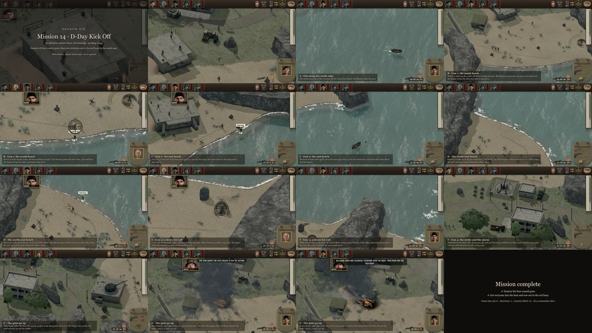](docs/screenshots/storyboards/m14.jpg)

### Mission 15 · The End of the Butcher

The Spy takes a German uniform from a balcony, injects seven guards and holds a patrol in talk; the Marine spears one guard from under the water; the Driver parks the fuel tanker on the tram line and drives the tram into it, which destroys the headquarters as an accident, with no alarm; the Sniper shoots General Schleper with one round at the corner of his garden; all four leave in the van. *Game time 92:29 (film 9:10), 0 detections, 9 kills, all 4 commandos alive.*

[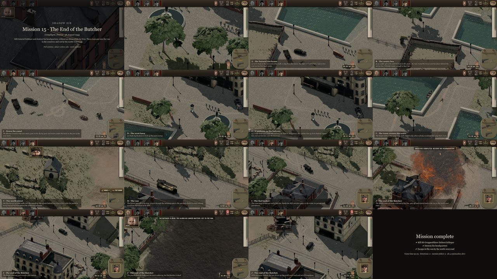](docs/screenshots/storyboards/m15.jpg)

### Mission 16 · Stop Wildfire

The Spy takes the German uniform from the clothesline and drives the lorry onto the bridge with the Sniper and the Marine aboard; the Spy holds one engineer in talk while the Sniper shoots the four bridge engineers and a sentry; the passing train runs down three more guards; all three drive off in the lorry by the south road. *Game time 20:04 (film 3:15), 0 detections, 8 kills, all 3 commandos alive.*

[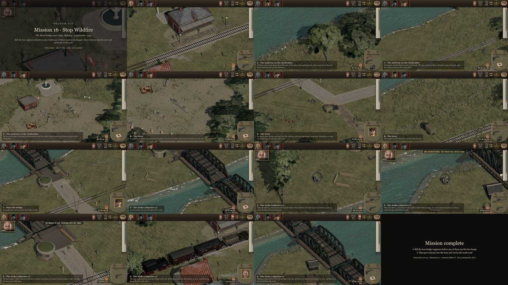](docs/screenshots/storyboards/m16.jpg)

### Mission 17 · Before Dawn

The Spy, in a German uniform, walks through the camp to the prison yard's back gate and opens it, injects the four men of the west strip one by one, and slides the bridge out over the gorge by the lever on the winch lorry, so that the Green Beret and the Marine cross; she holds Patrol 17 at the road bridge in talk while the Green Beret knifes its three men, and injects e5 when the Green Beret's decoy has drawn him out of the yard; the Marine, swimming under water, harpoons the three men of Patrol 16 while the Spy holds them, and the Green Beret's decoy behind the bunker turns its gunner away for good; in the prison yard the Green Beret knifes e8, e9 and e10 and the Spy injects e11 and e12; on the north bank the Spy injects e14, e22, e24, e25 and e27, the Marine harpoons e15, e18, e19, e21 and the machine-gunner e23 from the river, and the Green Beret crawls over the road bridge and knifes e20 while the Spy holds him in talk; the Spy then holds Patrol 26 fifty metres from the lorry while the Green Beret opens the cage, and Claude Gilbert and his four men walk out with him, over the road bridge and up the north road, and all eight climb into the lorry. *Game time 53:48 (film 9:26), 0 detections, 27 kills, all 3 commandos alive.*

[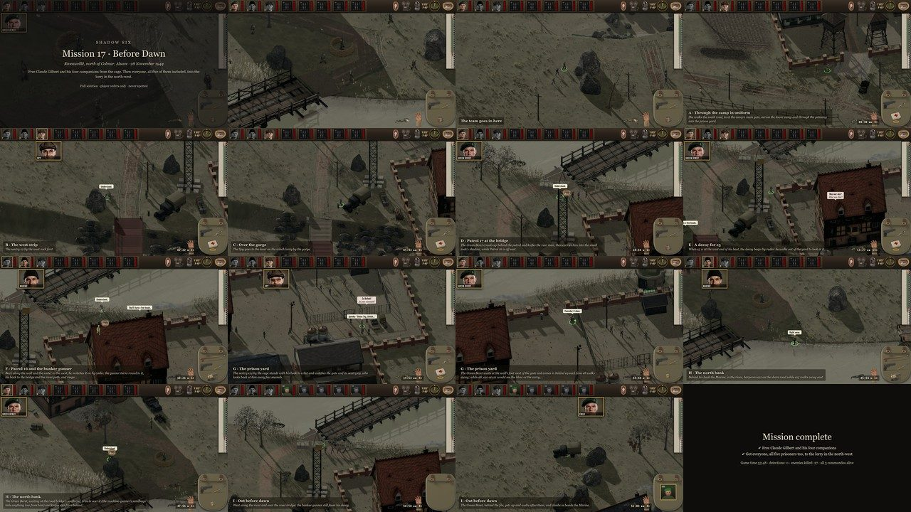](docs/screenshots/storyboards/m17.jpg)

### Mission 18 · The Force of Circumstance

The Marine dives under the bridge to the north island, harpoons the sentry beside the moored boat and carries the boat back; he harpoons the machine-gunner and a walker on the bridge island from the water and rows the Sapper over, and the Sapper takes the three German charges from the green case; the Driver takes the lorry, with the other three aboard, up to the end of the bridge deck, where the Germans take it for one of their own; the Sapper crawls out, sets a charge at each of the three marked points and, back at the lorry's door, sets all three off, so that the span falls into the Maas; all four drive out in the lorry. The Green Beret takes no part but to ride in it. *Game time 27:54 (film 4:20), 0 detections, 3 kills, all 4 commandos alive.*

[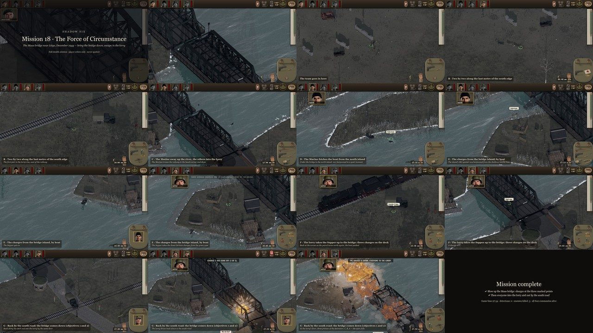](docs/screenshots/storyboards/m18.jpg)

### Mission 19 · Frustrate Retaliation

The Marine dives to the moored rowboat and ferries the team across the river; the Sniper shoots three guards and a guard dog from outside the palisade; the Green Beret climbs in, knifes one guard, lays a decoy and sets three barrels by the V2 rockets; the Sniper's fifth and sixth rounds into the barrels destroy all three rockets, and the Marine lets the current carry the boat out with all four aboard. *Game time 33:43 (film 4:25), 0 detections, 5 kills, all 4 commandos alive.*

[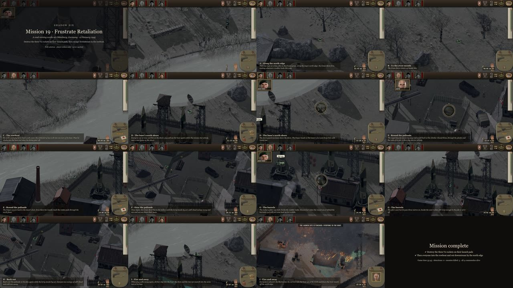](docs/screenshots/storyboards/m19.jpg)

### Mission 20 · Operation Valhalla

The Green Beret climbs the west wall and knifes fifteen guards on the terraces, in the south court and at the gate, and on the north range roof (one drawn up to a decoy on the gatehouse roof, Patrol 57 held at another); the Sniper shoots three, among them the AT gunner; the Sapper fires a remote charge from inside the Panzer III that destroys the headquarters (and the turret guard beside it); the Driver's tank gun destroys both V2 rockets and takes two guards on the way out; all six drive out in the Panzer III. *Game time 97:16 (film 11:38), 0 detections, 21 kills, all 6 commandos alive.*

[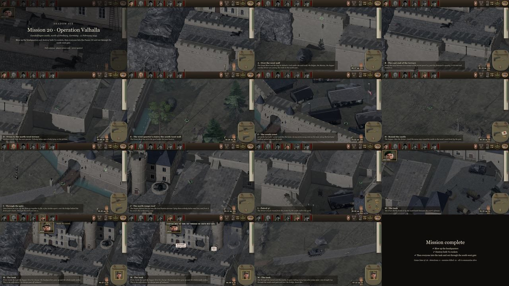](docs/screenshots/storyboards/m20.jpg)

The earlier reference set, an action frame and two scene frames for each of missions 1 to 20, is catalogued in
[verify/reference/README.md](verify/reference/README.md).

## What you get

- **The Behind Enemy Lines campaign**, rebuilt mission by mission from the original's 20 missions: all twenty play
  now, each with a scripted solution and a film (see [Status](#status)).
- **Six commandos with their original abilities and weapons**: the Green Beret (knife, decoy, shovel, climbing),
  Sniper, Marine (harpoon, boat, diving gear), Sapper (time and remote bombs, grenades, traps), Driver and Spy
  (uniform, lethal injection); each carries only what he had in 1998.
- **Talking portraits**: every commando speaks his lines in his own voice, with lip-synced portrait clips.
- **Newsreel briefings**: a 1940s newsreel announcer reads each mission's briefing as its words appear on screen
  (an original synthetic voice; Options → Sound → NARRATION, or N in the briefing).
- **Enemies that see and hear**: vision cones you can inspect, noise, footprints in the snow, bodies that get
  found, alarms and reinforcements.
- **A world that reacts**: snow with trails and footprints, rivers and fjords with swimmers and boat wakes, wind
  in the trees and flags, fire, smoke and explosions, physically based lighting.
- **Briefings, debriefings, quick save / load and a sandbox** to learn the controls; the *Beyond the Call of
  Duty* gadgets and units exist behind their own ruleset (sandbox only for now).
- **Solutions you can watch**: the finished missions come with a scripted full solution, played with player orders
  only and without a single detection. Replay it live in the game, or follow it as a captioned walkthrough with a
  camera director (both under `?debug`, see [Debug mode](#debug-mode)); `tools/solutions/film-mission.mjs` films it
  (see the [storyboards](#mission-storyboards)).

## Status

Work in progress. All twenty missions of the *Behind Enemy Lines* campaign are in the build and playable (in
campaign order, or any of them at once with `?debug`), with art (terrain, water, buildings, vehicles, animated
soldiers and commandos), vision cones, alarms, the knapsack, stealth kills, carrying bodies, explosives, briefings,
debriefings, and saving and loading. Where they stand:

- **Art, a scripted solution and a film finished:** the sandbox (M0) and all twenty missions. A solution is a
  full run with player orders only that wins without a single detection; it replays in the game, plays as a
  captioned walkthrough and is filmed (see [Mission storyboards](#mission-storyboards)).
- **Performance passes** (a steady frame rate through each mission's walkthrough in video mode) are under way:
  missions 2, 3 and 11 are done, missions 12, 15 and 18 are in progress and the others are queued. Engine-wide
  work (less garbage per frame, cheaper detailed characters, test-suite health) is merged.
- **Still to come:** the *Beyond the Call of Duty* campaign and some systems and polish. Work is merged and
  published as it is finished.

## System requirements

- A desktop browser with **WebGL 2**: Chrome or Edge (recommended) or Firefox; recent Safari should work but is
  less tested.
- A dedicated GPU is recommended for the High and Ultra presets; Low runs on integrated graphics.
- Mouse and keyboard. The first visit downloads the game (about 1 MB of code, then roughly 40–100 MB of models,
  textures and audio per mission, depending on the quality preset, shown by the loading bar); later visits come from the browser cache.

## Running locally

For development there is no build step: the repository root is the web root.

```sh
npm install                   # dev tools only (esbuild for the web build, playwright-core for the tests)
npm run serve                 # http://localhost:8080/  (node tools/serve.mjs [port])
```

The web build that GitHub Pages serves bundles and minifies the code and copies only the runtime assets:

```sh
npm run build                 # → dist/ (size report; fails over 950 MB or on a non-relative URL)
npm run serve:dist            # http://localhost:8080/shadow-six/, served like GitHub Pages
node tools/perf/measure-web-start.mjs   # first-visit start-up on a throttled 20 Mbit/s link
```

Any static file server also works, for example `npx serve .` or `python3 -m http.server 8080`. Use a desktop
browser with WebGL 2 (Chrome, Edge or Firefox; a discrete GPU is recommended for the higher presets).

URL parameters:

| Parameter | Effect |
| --- | --- |
| `?mission=m01` | Skip the title screen and load a mission (`m01`–`m20`; `m00` is the sandbox). |
| `?preset=low\|medium\|high\|ultra` | Rendering quality preset. |
| `?test=1` | Test mode: the simulation only advances through `window.__game.advance(s)`. |
| `?debug` | Debug mode: the DEBUG LEVEL SELECT instead of the title (see [Debug mode](#debug-mode)). `?debug=cones` also shows every vision cone. |

## Debug mode

Add `?debug` to the URL (`?debug=1`, `?debug=cones` and any other value work too; `?debug=0` is off), for example
`http://localhost:8080/?debug` or `https://jaher.github.io/shadow-six/?debug`. The game skips the title splash and
opens **DEBUG LEVEL SELECT**: every mission in the mission list, grouped as *Behind Enemy Lines* (by mission number),
*Beyond the Call of Duty* and *Sandbox / test maps*, each with its number, name, theater colour and icon, and a
thumbnail once you have played it in debug mode (a small capture cached in the browser). New missions appear by
themselves. Click or tap a level, or use the arrow keys and Enter. Esc (or *Main menu*) goes to the normal title.

Options in the overlay, remembered in `localStorage` (those marked * apply on the next launch):

| Option | Effect |
| --- | --- |
| Skip briefing (default on) | The level starts at once. |
| All commandos * | Adds every missing commando of the campaign beside the first one. |
| Invulnerable | Commandos take no damage. |
| Enemies blind & deaf | Inspection mode: enemies see and hear nothing, so they never react. |
| All vision cones | Every enemy cone stays drawn. |
| Free camera | No scroll clamp at the map edge and zoom from 0.125× to 4×. |
| Time ×0.5 / ×1 / ×2 / ×4 | Simulation speed. |
| Time of day * / Wind * | Dawn, noon, dusk or overcast lighting; any wind preset. |
| Info HUD | The corner readout of latency, triangles and memory (also F11). |

Keys while `?debug` is on: **F10** level select (also the small DEBUG button, bottom left), **PageDown / PageUp**
next / previous level, **Ctrl+R** instant restart, **F11** info HUD (below). The URL follows the level you are in, so
`?debug&mission=m05` reloads or shares that level directly, with the remembered options. Without the parameter none
of this exists, and nothing in the normal menus leads to it.

The **info HUD** sits in the bottom-left corner above the DEBUG buttons (with a finger: right of the MENU / TURN
buttons, or above them on a phone held upright). Frame numbers are the average, 95th percentile and worst of the last
2 seconds, so a single hitch stays readable for 2 s:

| Row | What it measures |
| --- | --- |
| frame, FPS | Time between two displayed frames (one `requestAnimationFrame` to the next). |
| main cpu | Main-thread ms of each frame: simulation ticks, render, texture uploads (`Game.frame`). |
| render cpu | The `Game.render` part of it: scene updates and the WebGL calls (not the GPU's own time). |
| input→frame | From a click, tap, key or wheel (the event's timestamp) to the end of the next frame drawn after it, over the last 32 inputs, plus the last one. GPU, compositor and display time come on top. |
| draws, tris | Draw calls and triangles of the whole frame, including the offscreen passes (water mirror, ocean / ripple / trail maps) drawn before the main view, whose share is shown as *offscreen*. |
| GPU MB | Live GPU allocations counted as they happen (`src/debug/gpu-mem-counter.js`, same rules as `tools/perf/mem-probe.js`): textures with every mip / face / layer, vertex and index buffers, renderbuffers, plus the canvas (estimated). |
| three.js, JS heap | The renderer's live texture and geometry counts; the JS heap in use (Chrome / Edge only). |

Below the table, a **perf graph** shows the last 15 seconds: each frame's time as a bar (green up to 16.7 ms, amber up to 33.3 ms, red above; one column per pixel keeps the worst frame in it, so a single hitch stays visible), the main-thread CPU as a blue line, dashed 16.7 / 33.3 ms guides, and the GPU memory as a violet line on its own scale. The **−** button shrinks the HUD to one line (FPS · frame ms · GPU MB) and **+** brings it back; the choice is remembered. Sampling runs only while the HUD is shown. In video mode the HUD starts minimized in the corner, with the caption moved clear of it; F11 hides or shows it there. Capture runs (`?test=1`, or `?debug=clean`) keep it hidden in video mode, so films stay clean.

### Solution replays

Missions with a saved full solution (`tools/solutions/<id>.solution.mjs`: so far the sandbox and missions 1, 2, 3, 5,
6, 8, 11 to 16, 19 and 20; the script is the one the mission's `<id>-solution` regression test plays) can be watched
being solved inside the game. In DEBUG LEVEL SELECT pick **▶ … — play the solution** under *Solution replays*; in a
mission press **F9** or the small **▶ SOL** button beside DEBUG. The mission is loaded fresh, as authored (the select's
*All commandos*, *Invulnerable*, *Enemies blind & deaf*, time of day and wind are ignored while it plays), and the
solution's player orders are issued live in the real game loop, starting at 1× (real time). The bar at the top has:

| Control | Effect |
| --- | --- |
| ■ STOP (or **Esc**, or F9 again) | Stops the replay; you take over the mission where it stands. |
| ❚❚ / ▶ | The game's own pause (P works too). |
| 1× 2× 4× 8× | Replay speed. |
| STEPS ▾ | Skip to a step (stage) of the solution: a later one fast-forwards to it, an earlier one reloads the mission and fast-forwards. |
| CAM | The camera follows the commando the last order went to (on), or is yours to scroll (off). |

A caption shows the current step, each checkpoint as it is reached and the latest order. Your own orders are held
while it plays. Adding a solution for another mission: write `tools/solutions/<id>.solution.mjs` (exports `solve(D,
ctx)` and `STAGES`; driver API in `tools/solutions/driver.mjs`). Nothing to register: the debug menu lists the folder
(the dev server answers `tools/solutions/?ls`; the web build bakes the list in and bundles every solution as a lazy
chunk).

### Video mode: watch a walkthrough

A guided film of a mission's solution, played live in the game. In DEBUG LEVEL SELECT pick **▶ … — watch the
walkthrough** under *Watch walkthrough · video mode*; in a mission press **F8** or the small **▶ VIDEO** button; or
open `?debug&walkthrough=m03` directly (`&speed=auto`, `&speed=4`, … picks the speed; no speed is AUTO). Missions without a solution are listed under *No walkthrough yet* (their
button says so). The mission loads fresh, as authored, on a title card (Start, Chapters, Exit); then:

- **The director** frames the commando who acts with what matters to the step (his target, the guard he slips past,
  the objective, a charge in its last seconds and the blast) in the part of the screen the walkthrough's bar and
  caption and the HUD leave free, with smooth pans and zooms, the mission's camera pitch (M3 looks down steeper over
  the plateau) and your camera angle, swung aside only while a building would hide the shot. The guards' cones that
  matter to the step are drawn.
- **The HUD follows the play**: every order selects the man it goes to, as a click on his portrait would — his
  portrait, his knapsack, his stance hand and the selection ring under him (two men ordered together: two rings).
- **An action is watched to its end**: a knife, an injection, a charge, the clothesline take, the raft inflated or
  folded… the camera stays on the man (and his target) until it has visibly finished, then a beat, before it moves
  on to the next man or chapter.
- **The Sniper's scope before every shot**: the scope comes up as a player's would — the real 2× lens, its ring,
  reticle and range — off the man, searches round him, settles on him with a breathing sway, a beat, then the shot:
  the recoil in the glass, the hit, the scope down. Two shots in a row (M2's e4 and e5) are one sequence that swings
  from the first man to the second. The clock is slowed for it (~2.4 s of wall time in AUTO, ~1.3 s at 4×); the
  shot still fires at its scripted tick.
- **The narration**: a chapter card at each stage, then one caption per step saying who does what and why
  (`tools/solutions/<id>.walkthrough.mjs`, format in [docs/walkthrough-format.md](docs/walkthrough-format.md)).
- **The bar** (finger-sized, under the HUD's top bar on every screen):

| Control | Keys | Effect |
| --- | --- | --- |
| ✕ | Esc | Back to the debug menu. |
| ⏮ / ⏭ | B / N | Previous / next step. Ahead fast-forwards from where you are; back reloads the mission and fast-forwards (the run is deterministic). ⏮ restarts the current step, or goes to the previous one in its first 4 s. |
| ❚❚ / ▶ | Space | Pause / play. |
| ☰ | L | Chapters and steps: jump to any of them. |
| ½× 1× 2× 4× | 1–4 | A fixed speed. |
| AUTO | 5 / A | The default: the speed follows the action, as the solution films did. Fast through walks and long crawls (4×, up to 8× while the frame rate holds); a true wait (the solution waits for a guard, a gap in the cones, a timer, and nobody acts) is skipped like a jump — about a second of wall time per 30–60 s of game — under a "⏩ waiting: <what for>" tag; while the step's men wait their moment the camera shows what moves (another commando at work, the guard they wait for); eased down to 1× ahead of what matters (a knife, a shot, a charge, the uniform, a switch, the raft, a near miss, a man closing in on the guard the step is about) and held there until the action has visibly finished; ½× for blasts and the escape; never above 2.5× while a new caption is read. The button shows the speed it plays at; a fixed speed leaves AUTO. |
| ⏩ | W | Skip waits (fixed speeds; on by default): while every commando waits, the pace rises up to 4× faster; it drops back the moment anything happens. |
| CC | C | Captions on / off. |
| CAM | F | Director on / off. Off is a free camera: scroll, drag and zoom as in the game; a drag or the wheel over the map also switches to it. CAM gives the camera back to the director. |

The walkthrough never changes the simulation: it wins exactly like the scripted run, checkpoint for checkpoint
(`tests/debug-walkthrough-sim.test.mjs`) — opened from a cold link too, however slow the connection: the load waits for
everything the gameplay world measures on the art, never racing it against a clock, so the run is the tested one tick
for tick (`tests/debug-walkthrough-cold.test.mjs`: M2 and M3 cold, M2 through a 4 Mbit/s link).

### Film a mission

Any mission with a solution can be filmed: the art opening (the title card over a slow pan of the map, from the
objective to the team's start), then the whole solution played in the real game with player orders only and captioned
step by step, with a soundtrack mixed from the game's own music, ambience and effects. One command makes the MP4 and a
4 × 4 contact sheet of its key frames (the [storyboards](#mission-storyboards) are those sheets):

```sh
# writes ../commandos-shots/videos/m01.mp4 and m01-sheet.jpg
node tools/solutions/film-mission.mjs m01 --sheet
```

It needs `npm install` (playwright-core) and a GPU, and takes from a few minutes to half an hour or more, depending on
the mission: it plays the solution twice, first without drawing to learn when things happen (kills, blasts,
checkpoints), then frame by frame, so run it in the background and read its progress lines. It also needs an `ffmpeg`
with libx264 and AAC (`--ffmpeg <bin>`, `$FFMPEG`, or the PATH). It checks the run (both passes won with identical
checkpoints, the file decodes with video and audio, its length matches the frames, it is audible and not clipping)
and ends with one `FILM_RESULT {json}` line; the exit code is 0 only when every check passed. Options:
`--videos <dir>` (or `$FILM_VIDEOS`; default `../commandos-shots/videos`), `--no-opening`, `--keep-frames`,
`--mix-only`, `--bitrate 1400k` or `--crf 26`. An optional `tools/solutions/<id>.cut.mjs` words the captions and sets
fixed shots and speeds for one mission; the details are in [docs/mission-videos.md](docs/mission-videos.md). Films are
never committed to the repository.

## Controls

The controls follow the original game.

| Mouse / keyboard | Touch (phone, tablet) | Action |
| --- | --- | --- |
| Left click a commando or portrait, `1`–`6` | Tap a commando or his portrait; **long-press** a commando adds / removes him | Select (Shift adds to the selection); `0` deselects, `8` selects all |
| Left drag | — | Box select |
| Left click on the ground | Tap the ground; **double-tap** runs | Walk there; **double-click** runs |
| Right click | **CANCEL** button (shown while something is armed) | Cancel the armed item, else deselect |
| Click (Shift+click) an enemy | **Long-press** an enemy, or the eye button then tap | Show its vision cone |
| `C` / `S` | Posture button | Lie down and crawl / stand up |
| `X` knife, `G` pistol, `R` sniper rifle, `J` harpoon or trap, `B` bomb, `A` detonator, `E` grenade, `L` injection, `W` wire cutters, `K` first aid, `U` uniform, `Q` decoy, `T` boat, `D` diving gear, `F` shovel | Tap the item in the knapsack, then tap the target | Knapsack items (each commando only has his own) |
| `Tab` | — | Move the knapsack panel to the other side |
| Arrow keys, screen edges, middle drag | **One-finger drag** (flick to coast); two fingers also pan | Pan the camera |
| Mouse wheel, numpad `+` / `-` (or `=` / `-`) | **Pinch** with two fingers (spread = zoom in, about the fingers' midpoint) | Zoom; numpad `*` or `Backspace` resets |
| `Home` | — | Centre on the selection |
| `P`, `Esc` | **MENU** button (bottom left) | Pause and objectives, cancel |
| `F1` | ? button | Help |
| `F2`–`F7` | — | Split-screen camera views |
| `F8` / `F9` (`Ctrl+S` / `Ctrl+L`) | MENU → save / load | Quick save / quick load |
| `Ctrl+B` | Notes button | Notes |

On a touch screen a tap never pans and a drag never gives an order: a finger that moves more than 10 px is a drag, and a
second finger turns it into a pinch. Phones and tablets start on the *medium* quality preset (*low* on older mobile GPUs),
which also caps the rendering resolution; a quality picked in OPTIONS is kept.

## Weapons per commando (BEL 1998)

Each commando carries only the equipment he had in the original game; missions add or change counts.

| Commando | Weapons | Tools |
| --- | --- | --- |
| Green Beret | knife, pistol | decoy, shovel |
| Sniper | sniper rifle (limited rounds, 5 by default), pistol | first-aid kit if neither Driver nor Spy is deployed |
| Marine | knife, harpoon gun (unlimited, shorter range than the pistol), pistol | inflatable boat, diving gear |
| Sapper | pistol, bear trap, time bombs **or** remote bombs (never both); grenades per mission | detonator (remote bombs), wire cutters per mission |
| Driver | pistol; submachine gun (20 bursts) only in missions 1, 2, 4 and 10 | first-aid kit (6 doses) |
| Spy | pistol, lethal injection (unlimited) | enemy uniform (found on site); first-aid kit if no Driver |

The data lives in [src/items.js](src/items.js).

## Tests

```sh
node tests/unit/run.mjs      # npm run test:unit: pure simulation (grid, pathfinding, world, objectives, items…)
node tests/run.mjs [pattern] [--swiftshader] [--headed]   # npm test: browser tests in headless Chromium
```

The unit tests run on GitHub Actions for every push and pull request. The browser runner (`npm install` first,
for playwright-core) starts `tools/serve.mjs` on a free port and launches a cached playwright Chromium on the
real GPU (`--use-angle=gl`); `--swiftshader` uses software rendering. It fails on thrown errors, page errors,
`console.error` and HTTP errors. Screenshots go to `tests/out/` (git-ignored).

## Deployment

[`.github/workflows/pages.yml`](.github/workflows/pages.yml) builds the web target on every push to `master`
(`npm ci`, `npm run build`, see [tools/build/build.mjs](tools/build/build.mjs)) and deploys `dist/` to GitHub
Pages. The build bundles `src/` with esbuild (code-split, content-hashed file names), keeps every URL relative so
the site works under the `/shadow-six/` sub-path, adds `version.json`, a `404.html` that returns to the game and a
small service worker (`sw.js`).
`SS_DIST=1 node tests/run.mjs webbuild` checks the build in headless Chromium.

### Caching and offline play

A mission is downloaded once (40–100 MB). Inside a session, RESTART MISSION, quick load and loading a save of a
mission already played reuse what is in memory (textures, models, baked terrain and trees, shader programs): no
download, no loading screen. Between visits the service worker keeps every downloaded asset in the browser's Cache
Storage, keyed by content hash, so a new deploy only re-downloads the files that changed; code, HTML and manifests
always come from the network first (never stale). After a mission loads, the next campaign mission is downloaded in
the background when the connection is not metered or in data-saver mode. Once a mission is cached it also plays
offline. OPTIONS → CLEAR CACHED GAME DATA deletes the cache. Details: `docs/ARCHITECTURE.md` § Asset cache;
`node tools/perf/measure-restart.mjs` measures (re)load times on the build.
[`.github/workflows/ci.yml`](.github/workflows/ci.yml) runs the unit tests and the web build.

## Layout

```
index.html            entry page (dev: import map → vendor/three.module.js; the build bundles it)
styles/               screen, menu and HUD styles
src/main.js           boot: WebGL check → Game → assets → title
src/game.js           Game: states, fixed-step loop, mission loading
src/config.js         gameplay and render numbers
src/items.js          item catalogue and BEL default loadouts
src/core/             events, math, objectives
src/world/            grid (terrain, blocking, line of sight), pathfinding, world, map builder
src/entities/         units, commandos, enemies, vehicles, projectiles, interactables
src/ai/               perception, enemy brain, alarm
src/abilities/        one file per ability
src/engine/           renderer, camera, input, asset loading
src/input/            touch gestures and in-mission touch controls
src/physics/          blast, debris and ragdoll physics (Rapier)
src/render/           vision cones, selection markers, effects
src/art/              models, materials, terrain, water, characters
src/ui/, src/audio/   menus, HUD, briefings, credits; audio
src/debug/            debug mode: level select, solution replay, video mode (walkthrough), info HUD
src/missions/         mission definitions (m00 sandbox, m01–m20 the BEL campaign, b00 the BCD sandbox)
assets/               textures, models, HDRIs, audio, portraits, fonts (see CREDITS.md)
vendor/               three.js r186 and addons
tools/                dev server, web build (tools/build), asset build scripts (Blender, audio, portraits),
                      mission solutions, walkthroughs and films (tools/solutions)
tests/                browser tests and unit tests
docs/                 architecture, design spec, research notes, screenshots
```

Read [docs/ARCHITECTURE.md](docs/ARCHITECTURE.md) before changing module interfaces.

## Credits

All third-party material is listed with its source, author and licence in [CREDITS.md](CREDITS.md). In short:

- Code: three.js and its addon libraries (MIT / Apache-2.0).
- Textures, HDRIs and models: CC0 sets from Poly Haven and ambientCG, plus the project's own Blender and
  procedural models.
- Sound: CC0 / public-domain recordings and the project's own synthesis. Fonts: SIL OFL and Apache-2.0.
- Briefing photographs: public-domain wartime photographs (Imperial War Museums, via Wikimedia Commons).
- **AI-generated media.** The commando portraits and their talking animations were generated for this project
  (Z-Image-Turbo, JoyVASA and LivePortrait), and the voices were synthesised (Kokoro and Chatterbox). The faces
  come from written descriptions only; no real person's likeness or voice is used.

The original game, *Commandos: Behind Enemy Lines*, was created by Gonzo Suárez and Pyro Studios and published
by Eidos Interactive in 1998. This project exists out of admiration for it.

## License

The original source code is released under the [MIT License](LICENSE). Assets in `assets/` and the libraries in
`vendor/` keep their own licences; see [CREDITS.md](CREDITS.md) and [vendor/LICENSE](vendor/LICENSE).
